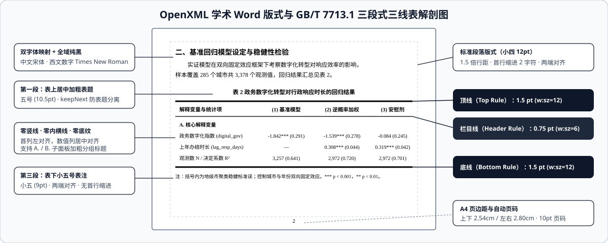
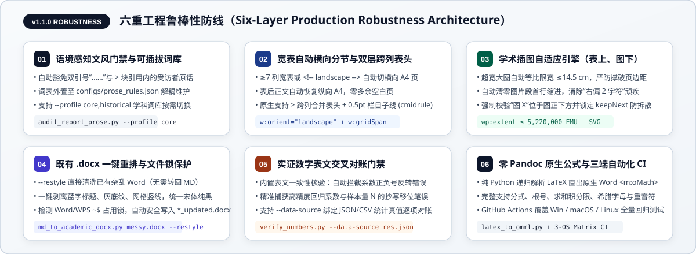
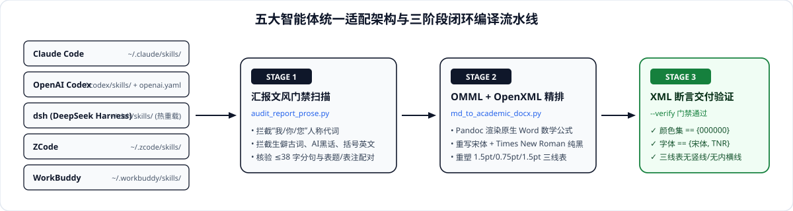

<div align="center">


<br/>

[](https://github.com/icgma/academic-report-docx/releases/tag/v1.1.0)
[](https://github.com/icgma/academic-report-docx/actions)
[](#六五大智能体安装与调用指南)
[](#六五大智能体安装与调用指南)
[](#六五大智能体安装与调用指南)
[](#六五大智能体安装与调用指南)
[](#六五大智能体安装与调用指南)
[](./LICENSE)

**把“客观平实的社科工作汇报文风”、“实证数字交叉对账”与“宋体 + Times New Roman 纯黑三段式三线表 Word 规范”凝练为一套跨平台 Agent 技能。**

[设计初衷](#一为什么需要这个技能) · [行文规范](#二行文风格规范客观平实的学术汇报体) · [版式解剖](#三word-版式规范gbt-77131-三段式三线表) · [v1.1 六重鲁棒性](#四v110-六重工程鲁棒性防线) · [五大终端安装](#六五大智能体安装与调用指南) · [命令行速查](#七独立命令行用法cli-quickstart)

</div>

---

## 一、为什么需要这个技能？

用大模型生成发给合作者、课题组负责人（PI）或审稿团队的**阶段性研究汇报 Word 文档**时，通常会在“文风”、“数字可靠性”和“排版”三端同时踩坑：

1. **文风摇摆失准**：要么写成满篇“我把……整理好了，你看合不合适”的**第一人称口语聊天腔**，缺乏科研文档应有的客观分寸；要么滑向另一个极端，堆砌“赋能、双轨奏疏、藩臬铨选、跨库实体链接、定稿宽表”这类**晦涩古语与 AI 句法压缩饼干**，还在中文句子里每隔几个字塞一个英文缩写括号，让人读三行就发紧。
2. **表文数字偶发错漏**：正文综述回归结果时容易出现**正负号抄反**（表中为 `-1.539***`，正文误写为正值）或小数位错位，人工肉眼逐行核对耗时费力。
3. **Word 排版粗糙失范**：Pandoc 或常规脚本直出的 `.docx` 往往带着默认的蓝色标题、等线/Calibri 字体、带竖线和灰底的网格表、多列回归宽表在纵向纸上挤成一列一个字、插图带两字符缩进歪斜，不符合中文社科与自然科学期刊通用的**“中文宋体 + 西文数字 Times New Roman + 纯黑配色 + 标准三段式三线表”**学术规范。

`academic-report-docx` 将经过真实大型实证项目打磨定型的**汇报行文准则**、**数字核验门禁**与**底层 OpenXML 精排引擎**打包为开箱即用的跨终端技能，原生适配 **Claude Code、Codex、dsh（DeepSeek Harness）、ZCode 与 WorkBuddy**。

---

## 二、行文风格规范：客观平实的学术汇报体

<p align="center">
  
</p>

本技能内置语境感知文风门禁脚本 [`scripts/audit_report_prose.py`](./scripts/audit_report_prose.py) 与可插拔词库 [`configs/prose_rules.json`](./configs/prose_rules.json)，在编译 Word 前逐行执行硬核检查：

| 检查维度 | 强制标准 | 自动拦截反例 | 标准替代表述与 v1.1 语境机制 |
| :--- | :--- | :--- | :--- |
| **1. 汇报人称视角** | **零第一 / 第二人称代词**（引语豁免） | 正文出现 `我`、`我们`、`咱们`、`你`、`您` | 改用 `本报告汇总……`、`清洗程序按……`；双引号 `“……”` 与 `>` 块引用内的受访者/档案原话自动豁免 |
| **2. 可插拔领域词库** | 用现代社科直白准确术语 | `抑或 / 确系`；历史扩展档 `奏疏 / 藩臬 / 铨选` | `--profile core` 拦截通用套话；`--profile core,historical` 按需叠加历史制度生僻词检查 |
| **3. 拒绝 AI 套话俗喻** | 拆解复合名词砖块与口语俗喻 | `跨库实体链接`、`定稿宽表`、`毛坯 / 精装修 / 对账` | 直接写明具体处理动作、输入输出与核对规则 |
| **4. 正文去括号路障** | 叙述句内禁塞纯英文缩写括号 | *“条件随机缺失（MAR）”*、*“假说一（H1）”* | 正文纯中文流畅叙事；斜体变量名 `*var*` 统一归入三线表 |
| **5. 均匀密度与图表题序** | 单分句 **≤ 38 汉字**；**表上、图下** | 50 字不换气长句；把 `图 1` 写在图片上方 | 短句衔接；强制核验“表题在表上 + 表下表注”与“插图在上 + 图题在图下” |

---

## 三、Word 版式规范：GB/T 7713.1 三段式三线表

<p align="center">
  
</p>

编译脚本 [`scripts/md_to_academic_docx.py`](./scripts/md_to_academic_docx.py) 直接重写 `.docx` 压缩包内的 `word/styles.xml`、`word/document.xml` 与 `word/footer1.xml`，在 OpenXML 层面锁定全部版式细节：

- **中英数双字体分离**：所有中文字符（`w:eastAsia`）强制绑定 **`宋体`（SimSun）**；所有英文字母、阿拉伯数字与西文标点（`w:ascii / w:hAnsi`）强制绑定 **`Times New Roman`**；公式（`<m:oMath>`）绑定 **`Cambria Math`**。
- **全域 100% 纯黑色（`#000000`）**：自动剥离全部蓝色标题、灰色副标题、超链接染色与下划线、代码块灰底与单元格底纹。
- **标准 A4 纵横混排分节**：常规正文采用纵向 A4（上下边距 `2.54 cm`、左右边距 `2.80 cm`），页脚居中 `10pt` 自动页码；当遇到 **7 列及以上宽表**（或表题前标注 `<!-- landscape -->`）时，自动将该表的“表题 + 表体 + 表注”包裹进独立的**横向 A4 分节页**，表后正文自动恢复纵向排版。
- **标准三段式三线表（支持双层跨列分组表头）**：
  1. **第一段（表上表题）**：`表 X ……` 位于表正上方，五号（`10.5pt`）加粗居中，锁定 `keepNext` 防止表题与表体跨页断开；
  2. **第二段（三线表体）**：顶线 **`1.5pt`**（`w:sz="12"`）、跨列分组子线 **`0.5pt`**（`w:sz="4"`，`cmidrule`）、主栏目底线 **`0.75pt`**（`w:sz="6"`）、底线 **`1.5pt`**（`w:sz="12"`），**彻底清除全部竖线与表体内部横线**；原生支持双层表头跨页重复（`w:tblHeader`）、回归系数与括号标准误双行紧凑绑定、以及 `A. ...` / `B. ...` 子面板加粗分组行；
  3. **第三段（表下表注）**：`注：……` 紧贴表底下方，小五号（`9pt`）两端对齐、无首行缩进。

---

## 四、`v1.1.0` 六重工程鲁棒性防线

<p align="center">
  
</p>

1. **语境感知文风门禁与可插拔词库**：自动豁免中文双引号 `“……”` 与块引用 `>` 内的质性访谈原话和史料引文，词表解耦至 [`configs/prose_rules.json`](./configs/prose_rules.json)，支持 `--profile core,historical` 或 `--rules` 自定义切换。
2. **宽表自动横向分节与双层跨列表头**：`≥ 7` 列多模型回归宽表（或 `<!-- landscape -->` 标记）自动切换至横向 A4 分节页；表头首行写入 `>` 即可自动合并生成 `<w:gridSpan>` 跨列分组表头与 `0.5pt` 栏目子线。
3. **学术插图自适应引擎（表题在表上、图题在图下）**：自动将超宽图片等比缩放限宽至 `≤ 14.5 cm`，清零图片段首行缩进消除“居中右偏两字符”问题，自动处理 `.png / .jpg / .svg` 并锁定 `keepNext` 紧贴下方居中粗体 `图 X`。
4. **既有 `.docx` 直接清洗重排（`--restyle`）与占用锁保护**：合作者发来的彩色网格表 `.docx` 无需转回 Markdown，一条 `--restyle` 命令直接洗成宋体 + Times New Roman + 纯黑三线表；若目标文件正在 Word/WPS 中打开（存在 `~$` 锁），自动安全写入 `*_updated.docx` 绝不报错崩溃。
5. **实证数字表文交叉对账门禁（`verify_numbers.py`）**：自动交叉比对正文与引用表格，拦截系数正负号反转与高精度小数抄写笔误，并支持 `--data-source results.json` 与统计脚本导出的真实计算结果逐项对账。
6. **零 Pandoc 原生 OMML 数学公式引擎与三端自动化 CI**：内置 [`scripts/latex_to_omml.py`](./scripts/latex_to_omml.py)，即使在未安装 Pandoc 的裸机环境下也能将 LaTeX 分式、根号、求和积分与上下标直接编译为原生可编辑 Word `<m:oMath>` 公式；仓库配备 Windows / macOS / Ubuntu 三系统矩阵 GitHub Actions 自动回归测试。

---

## 五、三阶段闭环编译流水线

<p align="center">
  
</p>

---

## 六、五大智能体安装与调用指南

本仓库同时采用**根目录直装结构**（`SKILL.md` + `agents/openai.yaml`）与**目录索引镜像结构**（`skills/academic-report-docx/`），兼容一键全平台脚本安装、单终端克隆安装以及插件市场安装。

### 方式一：一键全平台自动安装（推荐）

克隆仓库后运行内置安装脚本，即可一次性部署到本机 **Claude Code、Codex、dsh、ZCode、WorkBuddy** 全部技能目录：

**Windows（PowerShell）：**
```powershell
git clone https://github.com/icgma/academic-report-docx.git
cd academic-report-docx
.\install.ps1
# 如只需安装到指定终端：
# .\install.ps1 -Target claude,codex,dsh,zcode,workbuddy
```

**macOS / Linux（Bash）：**
```bash
git clone https://github.com/icgma/academic-report-docx.git
cd academic-report-docx
chmod +x install.sh && ./install.sh all
```

---

### 方式二：按各智能体终端单独安装与调用

| 智能体终端 | 全局技能目录（用户级） | 项目级目录（团队共享） | 专属适配特性与触发方式 |
| :--- | :--- | :--- | :--- |
| **Claude Code** | `~/.claude/skills/academic-report-docx` | `<repo>/.claude/skills/academic-report-docx` | 支持直接克隆，或通过 `/skill-install https://github.com/icgma/academic-report-docx` 扫描 `skills/` 目录自动安装 |
| **OpenAI Codex** | `~/.codex/skills/academic-report-docx`<br/>`~/.agents/skills/academic-report-docx` | `<repo>/.agents/skills/academic-report-docx` | 内置 [`agents/openai.yaml`](./agents/openai.yaml) 与矢量/位图双尺寸图标，支持 `$academic-report-docx` 显式唤起 |
| **dsh (DeepSeek Harness)** | `~/.dsh/skills/academic-report-docx` | `<repo>/.dsh/skills/academic-report-docx`<br/>`<repo>/.agents/skills/academic-report-docx` | 严格遵循 `@deepseek-ai/dsh-skill-filesystem` 规范（`kebab-case` 名称 + `whenToUse` + Chokidar 免重启热重载） |
| **ZCode** | `~/.zcode/skills/academic-report-docx` | `<repo>/.zcode/skills/academic-report-docx` | 原生识别 `SKILL.md` 触发词，在实证分析与协作者审阅汇报阶段自动挂载 |
| **WorkBuddy** | `~/.workbuddy/skills/academic-report-docx` | `<repo>/.workbuddy/skills/academic-report-docx` | 原生提供 `display_name_zh`、`display_name_en` 与 `description_en` 双语技能面板元数据 |

<details>
<summary><b>展开查看各终端独立单行克隆命令</b></summary>

```bash
# 1. Claude Code
git clone https://github.com/icgma/academic-report-docx.git ~/.claude/skills/academic-report-docx

# 2. OpenAI Codex
git clone https://github.com/icgma/academic-report-docx.git ~/.codex/skills/academic-report-docx

# 3. dsh (DeepSeek Harness — 写入后 Chokidar 自动热加载，无需重启会话)
git clone https://github.com/icgma/academic-report-docx.git ~/.dsh/skills/academic-report-docx

# 4. ZCode
git clone https://github.com/icgma/academic-report-docx.git ~/.zcode/skills/academic-report-docx

# 5. WorkBuddy
git clone https://github.com/icgma/academic-report-docx.git ~/.workbuddy/skills/academic-report-docx
```

</details>

### 对话触发提示词示例

> “请调用 `academic-report-docx` 技能，把当前项目的数据清洗、缺失值检验和回归结果整理成一份发给合作者审阅的工作汇报 Word 文档（使用客观汇报风格、不要用第一人称，与 `results.json` 对账，导出宋体 + Times New Roman、纯黑、三段式三线表 `.docx`）。”

---

## 七、独立命令行用法（CLI Quickstart）

### 环境依赖
- **Python 3.9+**，安装 `lxml`：`pip install lxml`
- **Pandoc（可选增强）**：安装了 Pandoc 时自动调用 Pandoc + OpenXML 精排；**未安装 Pandoc 时自动无缝切换至内置纯 Python 原生 OMML 公式与 OpenXML 渲染引擎**，零外部二进制依赖即可输出完整可编辑公式与三线表。

### 1. 运行语境感知文风检查与实证数字对账
```bash
# 文风与图表三段式题序检查（支持 --profile core,historical）
python scripts/audit_report_prose.py examples/sample_empirical_report.md

# 表文数字一致性与外部 JSON 统计结果对账
python scripts/verify_numbers.py examples/sample_empirical_report.md \
  --data-source examples/sample_results.json
```

### 2. 编译标准学术 Word 文档并执行 OpenXML 断言验证
```bash
python scripts/md_to_academic_docx.py examples/sample_empirical_report.md \
  -o examples/sample_empirical_report.docx \
  --data-source examples/sample_results.json \
  --verify
```
输出示例：
```text
[OK] Compiled Academic Word DOCX via Pandoc (pandoc.exe) + OpenXML Post-Processor: examples/sample_empirical_report.docx
[PASS] OpenXML Verification Gate passed: 2 Three-Line Table(s), 0 Landscape Section(s), 0 Figure(s), 9 OMML Equation(s), 2,697 chars, 100% 宋体 + Times New Roman, pure black #000000.
```

### 3. 对既有杂乱 `.docx` 文档一键清洗重排（`--restyle`）
```bash
python scripts/md_to_academic_docx.py messy_draft.docx \
  --restyle -o clean_academic_draft.docx --verify
```

### 4. 运行完整自动化回归测试套件
```bash
python -m unittest discover -s tests -p "test_*.py" -v
```

> 仓库内已附带编译并核验通过的实证汇报样稿与真值数据源：
> - Markdown 源稿：[`examples/sample_empirical_report.md`](./examples/sample_empirical_report.md)
> - 统计结果真值 JSON：[`examples/sample_results.json`](./examples/sample_results.json)
> - 标准 Word 成稿：[`examples/sample_empirical_report.docx`](./examples/sample_empirical_report.docx)

---

## 八、仓库目录结构

```text
academic-report-docx/
├── SKILL.md                             # 核心技能指令文件（v1.1.0 五端通用元数据 + 三大自动门禁流）
├── agents/
│   └── openai.yaml                      # OpenAI Codex 原生界面配置与默认提示词
├── configs/
│   └── prose_rules.json                 # 外置可插拔文风词表配置（core 通用核心档 + historical 历史扩展档）
├── assets/
│   ├── hero-banner.svg                  # README 顶部概览横幅与 A4 样张预览
│   ├── prose-style-comparison.svg       # 三栏文风正反对比图解
│   ├── three-line-table-anatomy.svg     # 学术版式与 GB/T 7713.1 三段式三线表解剖图
│   ├── v11-robustness-shield.svg        # v1.1.0 六重工程鲁棒性架构图解
│   ├── multi-agent-workflow.svg         # 五大智能体适配与闭环架构图
│   └── icon.svg / icon.png              # 技能矢量与位图图标
├── scripts/
│   ├── audit_report_prose.py            # 语境感知文风、引语豁免与图表题序检查器
│   ├── verify_numbers.py                # 实证数字表文一致性与 JSON/CSV 真值对账门禁
│   ├── latex_to_omml.py                 # 零 Pandoc 纯 Python LaTeX -> 原生 Word OMML 公式编译器
│   ├── md_to_academic_docx.py           # Markdown/DOCX -> 学术规范 Word 编译器、宽表横向分节与断言器
│   └── sync_skill_mirror.py             # 同步生成 skills/ 子目录镜像以兼容多技能市场扫描器
├── references/
│   ├── prose_style_guide.md             # 详细文风指南与三组高频场景正反改写范例
│   └── openxml_typesetting_spec.md      # OpenXML 底层纵横分节、双层表头、插图限宽与三线表参数表
├── examples/
│   ├── sample_empirical_report.md       # 完整实证研究汇报标准模板（含公式与多面板三线表）
│   ├── sample_results.json              # 配套实证结果 JSON 真值对账示例文件
│   └── sample_empirical_report.docx     # 预编译通过 XML 核验的 Word 成品样稿
├── tests/
│   └── test_v11_suite.py                # 覆盖六大鲁棒性特性的端到端自动化单元测试套件
├── skills/
│   └── academic-report-docx/            # 面向 Claude /skill-install 与目录索引安装器的完整镜像包
├── .github/workflows/
│   └── ci.yml                           # Windows / macOS / Ubuntu 三平台矩阵自动化测试流水线
├── install.ps1                          # Windows PowerShell 一键多终端安装脚本
├── install.sh                           # macOS / Linux Bash 一键多终端安装脚本
└── LICENSE                              # MIT 开源协议
```

---

## License

Released under the [MIT License](./LICENSE) © 2026 [icgma](https://github.com/icgma).
